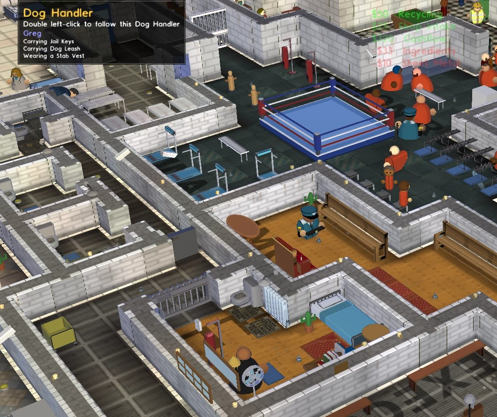

# PA3D Expanded – a 3D isometric view for Prison Architect

by **FxUK** · free fan mod · MIT licence (credit to FxUK must be kept, see [LICENSE](LICENSE))



PA3D Expanded turns Prison Architect's hidden 3D mode into a full isometric 3D view. It includes:

- a free-turning camera
- walls that can be cut away or lowered
- cartoon shading and outlines
- textured 3D models for furniture, kitchen food and people
- people sitting on seats, shadows and lamp light

> **Made with AI assistance.** Much of the code, the model generators and the documentation were written with an AI
> coding assistant (Claude, by Anthropic), directed, tested and reviewed in game by FxUK.  Whilst I am a software developer, I have not written any of the code for this mod myself and have been using it more so for seeing the capabilities of Claude on a game I absolutely love (probably one of my favorites of all time).

> **Released unfinished, as is.** I am not committed to developing it further; updates will only come if time
> permits. You are welcome to improve, develop and expand it. The licence allows it, as long as the credit to FxUK
> is kept.

## Download and install

Get the zip from the [Releases](../../releases) page and follow `PA3D Expanded - README.txt` inside it. You need Prison
Architect 1.02 (r11056), the 64-bit Steam version. On any other version the mod switches itself off.

Keys:

| Key | Action |
|---|---|
| F10 | Mod menu |
| Q / E | Turn the camera |
| Middle mouse | Turn the camera freely |
| F8 | Walls up / cutaway / down |
| F9 | Mod on / off |

## What is in this repository

| Folder | Contents |
|---|---|
| `dll/` | The mod: a proxy `glu32.dll` placed next to `Prison Architect64.exe`. `src/main.cpp` includes `src/parts/*.inc` (camera, GL hooks, walls, objects, drawing, menu, frame). `src/shaders.h` holds the replacement 3D-mode shaders. `src/game_offsets.h` holds the addresses for this exact game build. |
| `dll/third_party_imgui/` | Dear ImGui (MIT, see its LICENSE.txt), used for the in-game menu. |
| `model-generator/` | Python scripts that build the 3D models and textures from your own copy of the game's data. `pipeline/RUN.txt` gives the order. |
| `docs/` | Engine findings and notes. |
| `re-tools/` | Small reverse-engineering helpers. |

None of the game's own art is in this repository. The release zip contains models and textures made from it, which
belong to Introversion Software and Paradox Interactive.

## Building

The DLL is cross-compiled with [llvm-mingw](https://github.com/mstorsjo/llvm-mingw):

```
cd dll
TC=/path/to/llvm-mingw/bin ./build.sh      # -> build/glu32.dll
```

To build the models:

1. Extract the game's `main.dat` (a RAR archive) to get its `data` folder.
2. Run the scripts in the order given in `model-generator/pipeline/RUN.txt` (Python 3 with Pillow and numpy).

## Credits

PA3D Expanded by FxUK. The menu uses Dear ImGui by Omar Cornut and contributors (MIT).

Prison Architect is © Introversion Software / Paradox Interactive. This mod is not affiliated with or endorsed by
them.
